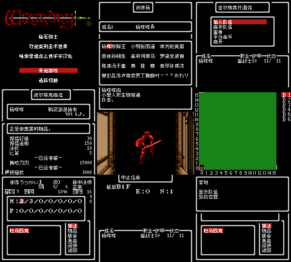

# 巫术Ⅲ钻石骑士

原输入：Wizardry III - Knights of Diamonds (Japan)

原输入完整SHA256：`6553ffd786bfe49dc40145895225664f821ff0d1be66124a9f370bacae931ebc`。此处“原输入”保留改版、既有汉化或地区修订身份，不一律称干净零售ROM。

| 字号 | 当前版本 | 音频 | 输出完整SHA256 |
| --- | --- | --- | --- |
| 8px | v0.1.1 | unchanged | `445210159d6b2d5cb33adbe863ac6cc76820c00014cf830d7213fce57abfb72a` |

## 源码与补丁

- 8px／v0.1.1／unchanged：完整修改源码：[下载](https://github.com/shiyi1133/youxi-hanhua-releases/releases/download/source-migration-20261022/wizardry-3-gbc-current-source-6384b7e6ac2b-public-r02.zip)（ZIP SHA256 `1b268a90b0d65cb2e0304ac7d154447818bff36c77e40faca6fd11269c573300`）；补丁：[下载](https://github.com/shiyi1133/youxi-hanhua-releases/releases/download/patch-migration-20261022/wizardry-3-gbc-current-patches.zip)（ZIP SHA256 `47c8549d266f890a95e64cf2b7cb5e04e0a5b59469fd6edbce19ea7d315af70b`）。

补丁须直接应用于完整SHA一致的实际原输入；普通字、大字和音乐变体分别核对。公开源码归档不表示本轮重新构建或通过新的运行验收。原作、字体、已有翻译及工具依赖的权利与许可，依各包对应许可保留。

## 范围与验证边界

- 8px／v0.1.1：普通原生8px；无大字版。
  全通、最终Boss、深层事件、全部法术/最长变量、死亡回城、实机与联机未测
  10px大字版未实现，本次仅交付普通8px
  旧自定义假名码可能显示为中文，先备份原生电池存档并按需改名

本次资料搬运未新增模拟器、实机或全通验收；未记录或未测试的范围不写成通过。问题单开放只表示尚未关闭，已关闭也不单独证明全部场景都修复。

[公开反馈及问题状态](feedback.md) · [报告BUG](https://github.com/shiyi1133/youxi-hanhua-releases/issues/new?template=bug_report.md)

## 对应版本截图

普通8px最终ROM真实九宫格；图中自然与诊断范围按说明区分。

图像SHA256：`0e9321328f4a38688392e2926af7a10bb7a68fdafb5a0aa521f46c0b4009efd9`；绑定ROM SHA256：`445210159d6b2d5cb33adbe863ac6cc76820c00014cf830d7213fce57abfb72a`。

