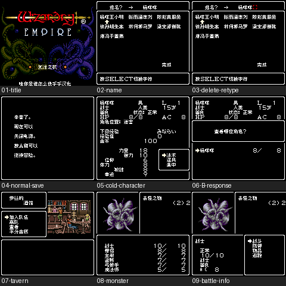

# 巫术帝国Ⅱ 复活之杖

原输入：Wizardry Empire - Fukkatsu no Tsue (Japan)

原输入完整SHA256：`b066a8fc2f9b6d04e5d61ca732c53da2cf1dbe51b7c613319d5a47adbf15d060`。此处“原输入”保留改版、既有汉化或地区修订身份，不一律称干净零售ROM。

| 字号 | 当前版本 | 音频 | 输出完整SHA256 |
| --- | --- | --- | --- |
| 8px | v0.1.3限定修复测试版 | unchanged | `0a11c2f5246d9b91ea9c544fee75ebb452831ba7f3a16b6ae3c481c46627f8f4` |

## 源码与补丁

- 8px／v0.1.3限定修复测试版／unchanged：源码包（完整性未独立确认）：[下载](https://github.com/shiyi1133/youxi-hanhua-releases/releases/download/source-migration-20261022-02c/wizardry-empire-2-current-source-a2d4b1f8a70a-public-r01.zip)（ZIP SHA256 `8b8995b3ec3be48804bf15a7187cb413ab752fb97810e8cfba602d366d6ca318`）；补丁：[下载](https://github.com/shiyi1133/youxi-hanhua-releases/releases/download/patch-migration-20261022/wizardry-empire-2-current-patches.zip)（ZIP SHA256 `19a6309eae389884d8c40b25ac1053b4d56779dbab43134ab2345a6b5b213266`）。
  该包已核对对应版本与字节安全；完整修改源码覆盖范围未独立确认。

补丁须直接应用于完整SHA一致的实际原输入；普通字、大字和音乐变体分别核对。公开源码归档不表示本轮重新构建或通过新的运行验收。原作、字体、已有翻译及工具依赖的权利与许可，依各包对应许可保留。

## 范围与验证边界

- 8px／v0.1.3限定修复测试版：普通Fusion Pixel8px既有范围；无大字；原生紧凑UI/图像范围按说明。
  补酒馆标题与四选项中文，修正怪物名双方NUL结束匹配及名称栏空白字模，保留v0.1.2角色页临时栈修复。
  仅一次自然遇敌，不等于全部怪物自然覆盖；234名称/描述×3尾部702组双消费者、459分配器、218地图、243物品、2363脚本均隔离诊断。
  偶发GBC提示本次未复现、未修复；既有反馈保持open。
  未验自然战斗胜利/全部施法、完整NPC招募、迷宫内手动退出保存完整路线、全部菜单组合/深层/结局/全通、实机或联机。
  短路线定时中断边界监测不代表全游戏栈证明；只普通8px，无大字且GBC专用非SGB。
  维护本次仅独立核ZIP/CRC/全SHA、原输入、BPS严格回补与截图逐像素绑定，未执行附包源码/依赖/模拟器或开展汉化。
  按用户AGENTS本轮Source上传0；完整源码、存档/即时状态/依赖二进制仅本地，不装入玩家ROM/补丁ZIP；原输入复用统一单ROM ZIP不重复上传。
  换版先备份原生电池存档；不保证任意历史即时状态跨版兼容。

本次资料搬运未新增模拟器、实机或全通验收；未记录或未测试的范围不写成通过。问题单开放只表示尚未关闭，已关闭也不单独证明全部场景都修复。

[公开反馈及问题状态](feedback.md) · [报告BUG](https://github.com/shiyi1133/youxi-hanhua-releases/issues/new?template=bug_report.md)

## 对应版本截图

巫术帝国Ⅱ 复活之杖 v0.1.3限定修复测试版 普通8px；提供方最终ROM画面，诊断/自然范围按图及证据明确标注，未新增维护运行。

图像SHA256：`1a50abadac1d00f3eb91a3ac05a5d0688cf6c862762a1f88e617b5c47f18daff`；绑定ROM SHA256：`0a11c2f5246d9b91ea9c544fee75ebb452831ba7f3a16b6ae3c481c46627f8f4`。

