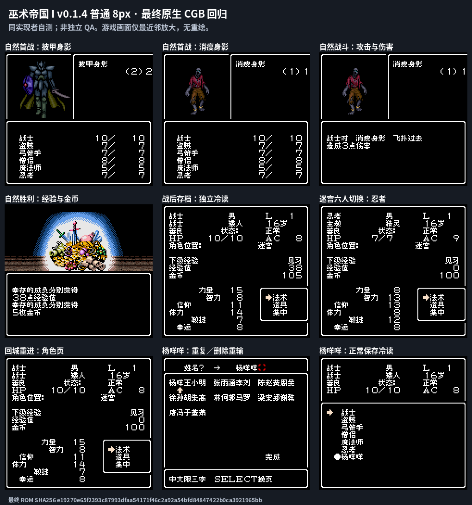
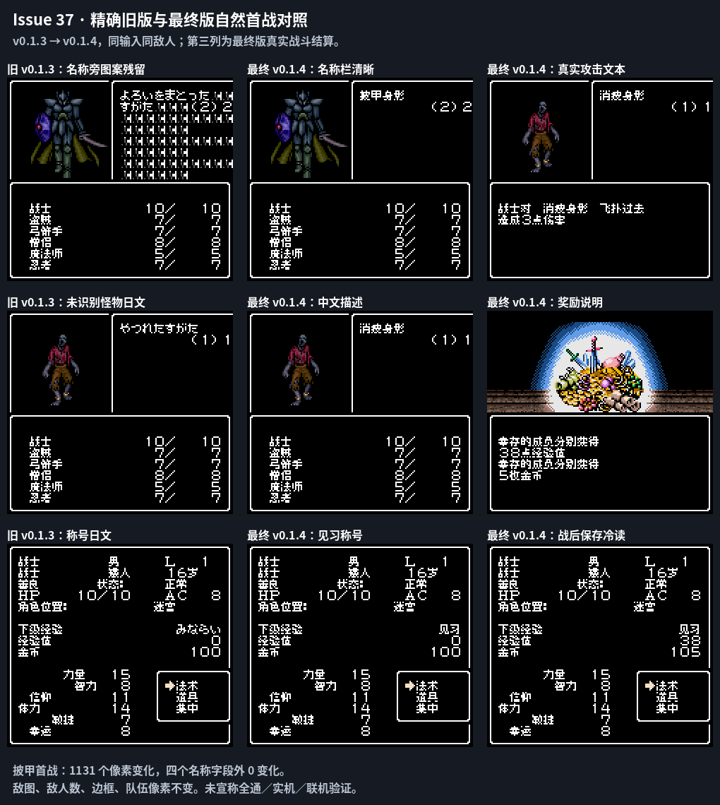

# 巫术帝国

原输入：Wizardry Empire (Japan, Rev 1)

原输入完整SHA256：`cd7f00d398bf30c3302cb814cb849761caa8aa0183ba7b4460677ec98d7f1472`。此处“原输入”保留改版、既有汉化或地区修订身份，不一律称干净零售ROM。

| 字号 | 当前版本 | 音频 | 输出完整SHA256 |
| --- | --- | --- | --- |
| 8px | v0.1.4限定修复测试版 | unchanged | `e19270e65f2393c87993dfaa54171f46c2a92a54bfd84847422b0ca3921965bb` |

## 源码与补丁

- 8px／v0.1.4限定修复测试版／unchanged：源码包（完整性未独立确认）：[下载](https://github.com/shiyi1133/youxi-hanhua-releases/releases/download/source-migration-20261022-02c/wizardry-empire-current-source-d41d6d27241b-public-r01.zip)（ZIP SHA256 `913bf78e28db4ef5f62eeed633a01658ff3fb5b33f1f31f97b67fcf8d51d0a2a`）；补丁：[下载](https://github.com/shiyi1133/youxi-hanhua-releases/releases/download/patch-migration-20261022/wizardry-empire-current-patches.zip)（ZIP SHA256 `1b82f3a307506573de0ffdc2fe08e522766f3dbd06beb15109b2b99ceb3fa060`）。
  该包已核对对应版本与字节安全；完整修改源码覆盖范围未独立确认。

补丁须直接应用于完整SHA一致的实际原输入；普通字、大字和音乐变体分别核对。公开源码归档不表示本轮重新构建或通过新的运行验收。原作、字体、已有翻译及工具依赖的权利与许可，依各包对应许可保留。

## 范围与验证边界

- 8px／v0.1.4限定修复测试版：普通Fusion Pixel8px既有范围；无大字；原生紧凑UI/图像范围按说明。
  修正怪物名称栏残留图案、未识别怪物描述/NUL尾部匹配，补经验/金币结算说明与角色“见习”称号；继承v0.1.3角色页/继续冒险栈与幸运字形修复。
  自然首战样本不能代表全部怪物、技能、宝箱掉落或深层剧情；全通、实机、联机未验。
  2196怪物/描述尾部及分配器178、RAM变量537、奖励10、称号156等为隔离诊断，非全部自然可达。
  短路径栈观测49不含IRQ、已知timer加10得59/64；一次IRQ57不代表所有调用者/阶段/中断/嵌套串口形式证明。
  新玩家v0.1.3报告的装备页/返城酒馆等残留未逐项提供修复证据；既有反馈复合残项保持open，不以怪物子项替代整条关闭。
  完整源码为附包150个source成员本地CRC/全SHA；provider另述d9f4…源码ZIP未作为嵌套ZIP附入，不把报告中的ZIP哈希冒称本次实得ZIP。
  维护本次仅独立核ZIP/CRC/全SHA、原输入、BPS严格回补与截图逐像素绑定，未执行附包源码/依赖/模拟器或开展汉化。
  按用户AGENTS本轮Source上传0；完整源码、存档/即时状态/依赖二进制仅本地，不装入玩家ROM/补丁ZIP；原输入复用统一单ROM ZIP不重复上传。
  换版先备份原生电池存档；不保证任意历史即时状态跨版兼容。

本次资料搬运未新增模拟器、实机或全通验收；未记录或未测试的范围不写成通过。问题单开放只表示尚未关闭，已关闭也不单独证明全部场景都修复。

[公开反馈及问题状态](feedback.md) · [报告BUG](https://github.com/shiyi1133/youxi-hanhua-releases/issues/new?template=bug_report.md)

## 对应版本截图

巫术帝国 v0.1.4限定修复测试版 普通8px；提供方最终ROM画面，诊断/自然范围按图及证据明确标注，未新增维护运行。

图像SHA256：`98039d92e23bf03f5722a827c2735c176fb796c5873c3e4296991d1f192bf2c6`；绑定ROM SHA256：`e19270e65f2393c87993dfaa54171f46c2a92a54bfd84847422b0ca3921965bb`。

旧版本与当前修复测试版的真实对比，按图内原版本标签区分。

图像SHA256：`e188c264b5f8ab4ba430bf7479d8676ea86fd385d3b970e7207df9324f11cd4d`；绑定ROM SHA256：`e19270e65f2393c87993dfaa54171f46c2a92a54bfd84847422b0ca3921965bb`。

