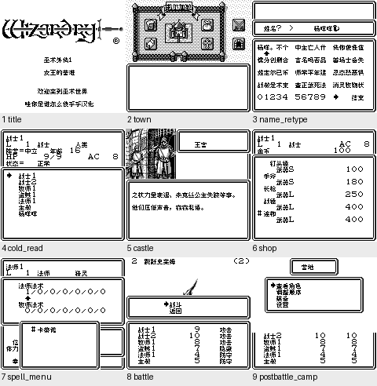

# 巫术外传1：女王的受难

原输入：Wizardry Gaiden I - Joou no Junan (Japan)

原输入完整SHA256：`c7e7d50bb123c49192f1cdf28d34addbf4d976d245d845796566d6fe89b9e648`。此处“原输入”保留改版、既有汉化或地区修订身份，不一律称干净零售ROM。

| 字号 | 当前版本 | 音频 | 输出完整SHA256 |
| --- | --- | --- | --- |
| 8px | v0.1.1限定修复测试版 | unchanged | `c13368fc52350094336b49eaa4176da2d313c6105c05c7ef2d2a2b1874856a1e` |

## 源码与补丁

- 8px／v0.1.1限定修复测试版／unchanged：源码包（完整性未独立确认）：[下载](https://github.com/shiyi1133/youxi-hanhua-releases/releases/download/source-migration-20261022-02c/wizardry-gaiden-1-current-source-49d627f9b318-public-r01.zip)（ZIP SHA256 `bac6d4903c09d9e1d62f66ec978d8f8974de340d4c489f8f7d98ffff25024fe9`）；补丁：[下载](https://github.com/shiyi1133/youxi-hanhua-releases/releases/download/patch-migration-20261022/wizardry-gaiden-1-current-patches.zip)（ZIP SHA256 `63ee8472183d610975fec49c925b955e6266877ec4b6364c4ab169e22a7a13a1`）。
  该包已核对对应版本与字节安全；完整修改源码覆盖范围未独立确认。

补丁须直接应用于完整SHA一致的实际原输入；普通字、大字和音乐变体分别核对。公开源码归档不表示本轮重新构建或通过新的运行验收。原作、字体、已有翻译及工具依赖的权利与许可，依各包对应许可保留。

## 范围与验证边界

- 8px／v0.1.1限定修复测试版：Fusion Pixel原生8px，16px原行距；DMG灰阶，无10px。
  既有反馈城堡入口及自然战后营地旧图块暴露路径局部修复；玩家完整字表花屏未自然复现。
  巫术外传Ⅰ v0.1.1 Fusion Pixel普通原生8px限定刷新修复测试版；原生16px行距与窗口保留，无10px实际交付。原生GB/DMG灰阶，非SGB/CGB彩色。
  修复声明具体为既有反馈：城堡入口撤分区/清旧图前关屏再开屏；战后营地仅清上240格后开屏，保留底120格队伍区域。提供方原版/旧v010对照、城堡120帧及自然首战后营地/角色菜单有有限重跑。
  玩家第二张完整字符表花屏的精确画面没有自然复现；只确认并修复两处已观察旧地图暴露路径，不能称原玩家全反馈已解决或自动关闭复合既有反馈。
  只读CPU断点的上240空白格和底120不变属于instrumented read-only证明，不冒称纯自然截图，也未修改内存、寄存器或战斗进度；维护本轮未另跑CPU或游戏。
  九宫格对应最终ROM9张DMG原生帧；各自按提供方自然输入/同ROM续接/电池冷读元数据分类，不冒称九格都同一连续全程。castle after图是实际短空白过渡帧，不当正常对白截图或全故障遮盖证明。
  provider正常建角/改名杨咩咩、删除重复重输、7英数/3汉字边界、脑脑改名、退出训练保存及新进程电池冷读、城镇/商店购买/王宫四页/首层同格转向战斗/战后恢复均为限定路线。
  109剧情记录是原生渲染器注入诊断，8物品极限背包为合成诊断，不代表109自然事件或自然获得全部物品；967候选翻译记录不是全作完成百分比。
  全通、深层自然事件/口令、全部敌人及最长动态变量、所有战斗变体、实机/联机、原玩家ROM字节和环境、全部跨版电池档组合与跨版即时状态未验。换版前备份电池，不加载旧版即时状态。
  维护只核附件安全/CRC/全SHA、统一原件本地回读副本和独立BPS精确套用、8px字形静态匹配和9帧像素；未执行附包Source/QA代码、未做源码重建或新模拟器运行。提供方自测非独立人员QA。
  A与B内source part1/part2是一个完整工程的两个普通ZIP，须一起合并保留；最新用户AGENTS排除Source/QA/程序上传，因此全部仅本地，旧Source历史另保留。按本轮最新Git与实际原报告核对后续资格，发布前仍需重读避免并发覆盖。
  Source part1的RGBDS官方上游tar.gz内有98个.gb/.gbc等测试夹具成员（部分是零字节或短期望输出）；因此不接受“整个递归源码组无ROM类文件”的包内断言。全部Source/QA资料仍仅本地，clean三资产不含这些夹具。

本次资料搬运未新增模拟器、实机或全通验收；未记录或未测试的范围不写成通过。问题单开放只表示尚未关闭，已关闭也不单独证明全部场景都修复。

[公开反馈及问题状态](feedback.md) · [报告BUG](https://github.com/shiyi1133/youxi-hanhua-releases/issues/new?template=bug_report.md)

## 对应版本截图

巫术外传1：女王的受难 v0.1.1限定修复测试版 普通8px；Fusion Pixel原生8px，16px原行距；DMG灰阶，无10px；提供方最终ROM画面，维护实际查看九宫格，不代表维护重跑游戏。

图像SHA256：`2e03183cce4b4fed36dca6cba3319aa026edd7943d029c476315806312307149`；绑定ROM SHA256：`c13368fc52350094336b49eaa4176da2d313c6105c05c7ef2d2a2b1874856a1e`。

