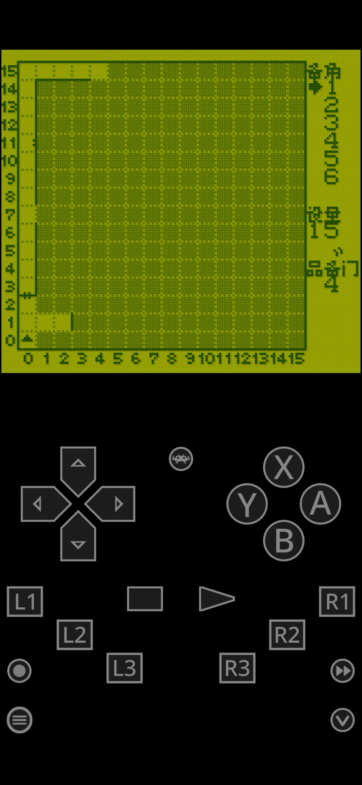

# 巫术外传1：女王的受难：公开反馈

以下为已公开证据摘录，不能自动当成已经复现或修复。下载／存档分享地址、本机路径或项目署名文字省略时逐条标记。

## 154039412428

63楼 · ♬肚皮吸碗🎶 · [原回帖](https://tieba.baidu.com/p/11092365551?pid=154039412428#154039412428)

>  : 回复 哇你是谁怎么傻乎乎 :发现两个地方会出现一帧花屏。图1是在点击城堡时，对话框刷新对话的一瞬间。图2是在地牢里随便一场战斗结束之后，打开菜单的一瞬间。

[玩家公开图片](https://tiebapic.baidu.com/forum/pic/item/ab0f4f2309f79052d0fe6e394af3d7ca7acbd57b.jpg)（玩家反馈图，不作当前最终ROM运行证明）

[玩家公开图片](https://tiebapic.baidu.com/forum/pic/item/e0cb05338744ebf84c904d389ff9d72a6159a77b.jpg)（玩家反馈图，不作当前最终ROM运行证明）

## 154044953905

63楼 · ♬肚皮吸碗🎶 · [原回帖](https://tieba.baidu.com/p/11092365551?pid=154044953905#154044953905)

> 经测试巫术外传1代v0.1.1字体8px仍有如下问题。 图1是在城内从小建筑里返回到地图画面时会有一帧花屏。 图2和图3是在地牢里，遇到有对话框的门时有乱码遮挡背景图。

## 问题状态

- [待复现] 巫术外传1：城堡对白刷新及战斗后开菜单瞬间花屏：开放；公开问题单待单独建档。

问题单开放不等于正在修复；关闭不自动代表所有报告症状全部验收。玩家实际ROM SHA未知时仍保留未知，当前版本的参考SHA见[游戏页面](README.md)。

## 20261025-1619 公开反馈更新

按当前实际未关闭问题去重：纯BUG 1 项，建议/覆盖等 0 项，分类待核 0 项。开放不代表正在修复。

- v012城镇返回首帧与中文门提示覆盖墙纹已修；自然三返回/建筑/王宫/首战战后营地，长门及符文关闭以原生函数指针诊断。旧原案玩家图2整表瞬间花屏曾未自然复现；最新材料未明确逐项证明该完整原现象闭环，保持open更准确。（记录版本：v0.1.2）：限定证据已核验；保持开放；该证据不代表当前最新版或整作全通。

玩家实际完整ROM字节未知时仍保留未知；自然流程、原生消费者诊断及静态证据分别记录，不外推实机或全流程。

## 20261031-0434 新反馈

玩家明确报告v0.1.2普通8px，带拥有查看地图魔法的精灵族法师在迷宫行走，施放“杜马皮克”查看地图时右侧乱码。公开原始截图可见地图右侧字形和数字混排，仅为静态图证，未由维护运行重现；实际ROM完整哈希未知。

[原反馈](https://tieba.baidu.com/p/11092365551?pid=154088588714#154088588714)

> 经测试，巫术外传1代v0.1.2 字体8px版，带着拥有查看地图魔法的精灵族法师在迷宫里行走时，使用精灵族法师的查看地图魔法“杜马皮克”查看地图时，画面右边是乱码

原字节SHA256 `6986f310d6ce2bd08d49d9d4fa3a2a33fbb8141ea82678171edf056e4924e5d1`，551563字节；静态玩家截图。

[已核公开登记答复](https://tieba.baidu.com/p/11092365551?pid=154089786660#154089786660)：《巫术外传1》v0.1.2 普通8px施放“杜马皮克”后地图右侧乱码已记录，后续排查。

历史反馈及旧修复证据保持；此次登记不表示维护已复现、修复、通关或实机验收。
