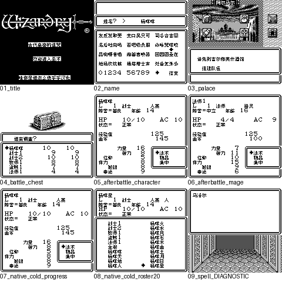

# 巫术外传Ⅱ古代皇帝的诅咒

原输入：Wizardry Gaiden II - Kodai Koutei no Noroi (Japan)

原输入完整SHA256：`2e2d7ed9efbd9b972bac2e248a4a02bb03603d456aca1cafc3ca5658e4d755cd`。此处“原输入”保留改版、既有汉化或地区修订身份，不一律称干净零售ROM。

| 字号 | 当前版本 | 音频 | 输出完整SHA256 |
| --- | --- | --- | --- |
| 8px | v0.1.1限定修复测试版 | unchanged | `3257a6a54245de8912aca154a2417a8be1891838cff73c0a0edc5f426b9b3989` |

## 源码与补丁

- 8px／v0.1.1限定修复测试版／unchanged：源码包（完整性未独立确认）：[下载](https://github.com/shiyi1133/youxi-hanhua-releases/releases/download/source-migration-20261022-02c/wizardry-gaiden-2-current-source-f63583fc2d84-public-r01.zip)（ZIP SHA256 `d50113c55eb966a4cdac857e9d33c76c186bfc6cc1861a5fbdd66a2bd45fe745`）；补丁：[下载](https://github.com/shiyi1133/youxi-hanhua-releases/releases/download/patch-migration-20261022/wizardry-gaiden-2-current-patches.zip)（ZIP SHA256 `84bd3d72845248fca48109591673c43fbfad75d7b83a168c1c6ac35c28587da9`）。
  该包已核对对应版本与字节安全；完整修改源码覆盖范围未独立确认。

补丁须直接应用于完整SHA一致的实际原输入；普通字、大字和音乐变体分别核对。公开源码归档不表示本轮重新构建或通过新的运行验收。原作、字体、已有翻译及工具依赖的权利与许可，依各包对应许可保留。

## 范围与验证边界

- 8px／v0.1.1限定修复测试版：普通Fusion Pixel原生8×8；DMG灰阶，无10px。
  既有反馈：原生20人角色表与中文临时区重叠修复，补王宫首屏和64法术名字；保持20人及8KiB原生保存。
  v0.1.1普通Fusion Pixel原生8px／日本标注Rev0原输入的限定测试版；DMG灰阶，无10px或彩色SGB交付。
  提供方旧版同输入冷启动路线曾复现角色等级/HP257乱码，最终版检查了自然战斗胜利→宝箱→扎营→6角色页、125XP原生中断后新进程电池冷读；原64楼II/III口误已由玩家确认是II。
  提供方自然创建/删除/改名杨咩咩与咩咩杨、正常保存后独立进程冷读；20人正常创建、21人拒绝、退出训练场才提交保存、重新启动检查20人名字与原生列表回环；容量仍20人及8KiB原生电池。
  王宫第一页及后续页有提供方自然输入证据；64法术名称只是最终ROM文字消费者诊断显示和overflow0，不表示64法术自然习得、施放效果或平衡通过。
  1081译文/11保留记录、371行和1081控制语义比较、最大104字节/256限制及最小栈DF9E仅按提供方静态/采样记录，不能冒称深层全部栈或最长动态变量均实测。
  九宫格1–8来自最终ROM自然输入/同ROM检查点续接，9为明确标注DIAGNOSTIC；5与7完全同像素，分别是战后与原生冷读记录，不当作9个独立自然场景。旧v0.1.0 BEFORE图仅历史复现。
  深层迷宫、全通/全物品/结局、所有最长变量组合、全部法术效果、硬件或联机未验。已被v0.1.0写坏的旧电池不能承诺自动修复，先备份电池，不跨ROM哈希混用即时状态。
  维护本轮仅核ZIP/CRC/全SHA、独立BPS精确套用、9帧逐像素及封存记录；未执行附件代码、模拟器或净源码构建，不是独立人员游戏QA。
  原件复用最新统一索引已验证回读ZIP的本地未改字节副本，不称本轮新下载、不重复归档；clean-retail未独立认证。最新用户AGENTS排除Source，源包本地保留，旧Source历史不删除也不冒充新版源码。

本次资料搬运未新增模拟器、实机或全通验收；未记录或未测试的范围不写成通过。问题单开放只表示尚未关闭，已关闭也不单独证明全部场景都修复。

[公开反馈及问题状态](feedback.md) · [报告BUG](https://github.com/shiyi1133/youxi-hanhua-releases/issues/new?template=bug_report.md)

## 对应版本截图

巫术外传Ⅱ古代皇帝的诅咒 v0.1.1限定修复测试版 普通8px；普通Fusion Pixel原生8×8；DMG灰阶，无10px；提供方最终ROM画面，维护实际查看九宫格，不代表维护重跑游戏。

图像SHA256：`55d0f406f706741a6789359b422c4d5b9c742711e86aec39b76d6f6f8f4af85e`；绑定ROM SHA256：`3257a6a54245de8912aca154a2417a8be1891838cff73c0a0edc5f426b9b3989`。

