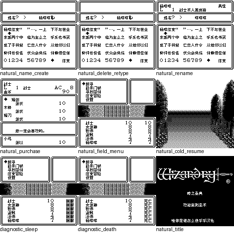

# 巫术外传Ⅲ暗之圣典

原输入：Wizardry Gaiden III - Yami no Seiten (Japan)

原输入完整SHA256：`aeb5380f81a8b4e05b9eca3f5d0178923a5460c2632be4b1173269b6bd043612`。此处“原输入”保留改版、既有汉化或地区修订身份，不一律称干净零售ROM。

| 字号 | 当前版本 | 音频 | 输出完整SHA256 |
| --- | --- | --- | --- |
| 8px | v0.1.1限定修复测试版 | unchanged | `6b704e43b03570904c37a81799a41e71df9e7b5be905b4f2a7381cd666c3079e` |

## 源码与补丁

- 8px／v0.1.1限定修复测试版／unchanged：源码包（完整性未独立确认）：[下载](https://github.com/shiyi1133/youxi-hanhua-releases/releases/download/source-migration-20261022-04/wizardry-gaiden-3-current-scope-source-public-r01.zip)（ZIP SHA256 `97845f246a856486f59419ccc5e3efabdfe7015f7cf4def355a0b55af7e99645`）；补丁：[下载](https://github.com/shiyi1133/youxi-hanhua-releases/releases/download/patch-migration-20261022/wizardry-gaiden-3-current-patches.zip)（ZIP SHA256 `f100a579caf99a7abd319969944d34f2b49eeb8ef85a98b513527ae0fe6bb440`）。
  该包已核对对应版本与字节安全；完整修改源码覆盖范围未独立确认。

补丁须直接应用于完整SHA一致的实际原输入；普通字、大字和音乐变体分别核对。公开源码归档不表示本轮重新构建或通过新的运行验收。原作、字体、已有翻译及工具依赖的权利与许可，依各包对应许可保留。

## 范围与验证边界

- 8px／v0.1.1限定修复测试版：普通Fusion Pixel 8px，GB原生；无独立大字版，非SGB彩色。
  既有反馈字体恢复/状态列及姓名补空格限定修复；新目标自然战斗未通过，七状态为受控诊断。
  既有反馈限定修复测试版；修正字体恢复时机、队伍状态四显示格右对齐和姓名补空格，不能据此宣称全部反馈或全游戏已验收。
  供应方自然路线涵盖新建杨咩咩、删除重输、改咩咩咩后改回、六人组队购买、野外菜单转场及正常保存后新进程恢复队伍/位置。
  七种异常状态的队伍行由受控内存状态写入验证，1347字模为逐tile字节诊断；两者都不是自然战斗或自然异常施加验收。
  本目标短路线未自然遇敌；自然战斗、施法攻击/胜利/死亡回城、深层全通、实机及20角色容量填满未通过本次验收。旧v0.1.0自然战斗材料仅作问题复现，未当成本目标通过。
  九宫格第7、8格分别为受控睡眠/死亡诊断；其余7格为供应方自然操作画面，其中第5格逐像素取自目标ROM逐4帧联系表。第1、2格画面字节相同，来自创建和删除重输的不同步骤，不伪称9个不同场景。
  部分自然/诊断采样在同目标的电池存档或同ROM即时状态上续接；真正新进程电池恢复另有freeze_cold证据，未借续接声称全部冷启动连续流程。
  原生20角色结构/容量保持仅静态核对，本次自然新建6人；沿用MBC5+128KiB SRAM，bank0–3原生游戏、bank4汉化缓存；建议备份后新开档，勿跨版本互载即时存档。
  普通Fusion Pixel 8px；无独立大字交付，历史10px素材不代表实现；GB原生DMG验证，非SGB彩色。
  提供方空目录源码重建与运行回执仅按供应方证据记录；维护仅做ZIP/哈希、独立BPS还原、图像像素和文本核对，未执行附包代码、源码重建或运行游戏。
  source ZIP的SOURCE_MANIFEST.json只有自身旧size/SHA记录不一致，其余109成员实际校验一致；不把该源码清单称全项通过。Source全保本地且本次不上传。

本次资料搬运未新增模拟器、实机或全通验收；未记录或未测试的范围不写成通过。问题单开放只表示尚未关闭，已关闭也不单独证明全部场景都修复。

[公开反馈及问题状态](feedback.md) · [报告BUG](https://github.com/shiyi1133/youxi-hanhua-releases/issues/new?template=bug_report.md)

## 对应版本截图

巫术外传Ⅲ暗之圣典 v0.1.1限定修复测试版 普通8px；普通Fusion Pixel 8px，GB原生；无独立大字版，非SGB彩色；提供方最终ROM画面，维护实际查看九宫格，不代表维护重跑游戏。

图像SHA256：`57a299e60b092fce7bffd38c5e0871c52090bdd6896ceaadb23b48d81c8a64bf`；绑定ROM SHA256：`6b704e43b03570904c37a81799a41e71df9e7b5be905b4f2a7381cd666c3079e`。

