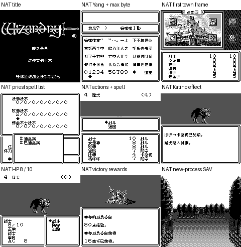

# 巫术外传Ⅲ暗之圣典 v0.1.2（限定测试版）

[源码与补丁Release](https://github.com/shiyi1133/youxi-hanhua-releases/releases/tag/wizardry-gaiden-3-v0.1.2) · [公开反馈](feedback.md) · [报告BUG](https://github.com/shiyi1133/youxi-hanhua-releases/issues/new?template=bug_report.md)

原游戏／实际输入：Wizardry Gaiden III - Yami no Seiten (Japan)

原输入完整 SHA-256：`aeb5380f81a8b4e05b9eca3f5d0178923a5460c2632be4b1173269b6bd043612`（524288字节）。

范围：原生8px城镇首帧字库、队伍法术列表别名及战斗截断返回契约限定修复。

## 8px v0.1.2 / unchanged

字号范围：原生8px城镇首帧字库、队伍法术列表别名及战斗截断返回契约限定修复。

目标完整 SHA-256：`3da9d8006b2b0f8b871298c8d028d9efae2b3bc7de9cea962df7f18f730e2ec3`（1048576字节）。

补丁：`Wizardry_Gaiden_III_v0.1.2_native8px.bps`，SHA-256 `3a72ee359a45151b56a06402949b62911a4a43c5f7df154617417e3ab94b0647`。

[源码（完整性未独立确认）](https://github.com/shiyi1133/youxi-hanhua-releases/releases/download/wizardry-gaiden-3-v0.1.2/wizardry-gaiden-3-v0.1.2-complete-source.zip) · [补丁包](https://github.com/shiyi1133/youxi-hanhua-releases/releases/download/wizardry-gaiden-3-v0.1.2/wizardry-gaiden-3-v0.1.2-patches.zip)

原生8px城镇首帧字库、队伍法术列表别名及战斗截断返回契约限定修复。；提供方对应最终ROM图证，具体自然/诊断类别见原图标签及材料；非维护运行、全通或实机验收。

## 测试及限制

提供方自然范围：提供方报告的自然/正常按键流程，维护未重跑。

提供方诊断范围：提供方明确标注的受控消费者、解锁或边界测试，不能冒充自然到达。

保存边界：仅按具体版本材料，不推定所有旧存档兼容。

维护本轮独立核原输入、补丁逐字节还原、ZIP/CRC、Source安全与原图字节；未执行提供方源码、未重建或运行ROM，未宣称独立人员QA、实机或全流程验收。

- 未验证：维护仅独立核用户输入ZIP/ROM完整SHA、补丁逐字节还原、ZIP成员/CRC与源包静态材料；未执行提供者源码、重建工程或运行ROM。
- 未验证：运行、自然按键、受控诊断、保存/新进程冷读等范围以所附提供方报告分别为据，不冒充维护重跑、独立人员QA、玩家验收、实机或全流程通关。
- 未验证：使用前备份普通存档；不跨ROM版本/字号套用即时状态，旧电池兼容仅按提供方实际样本说明。
