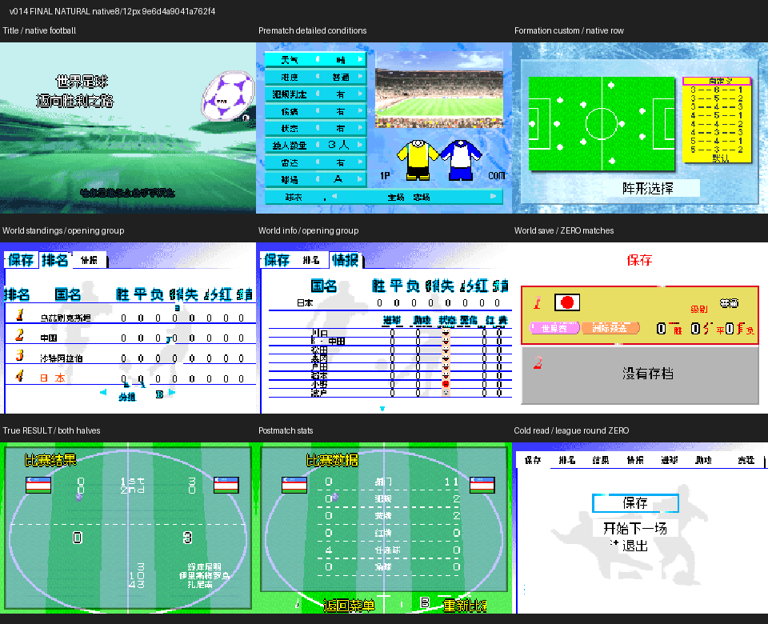
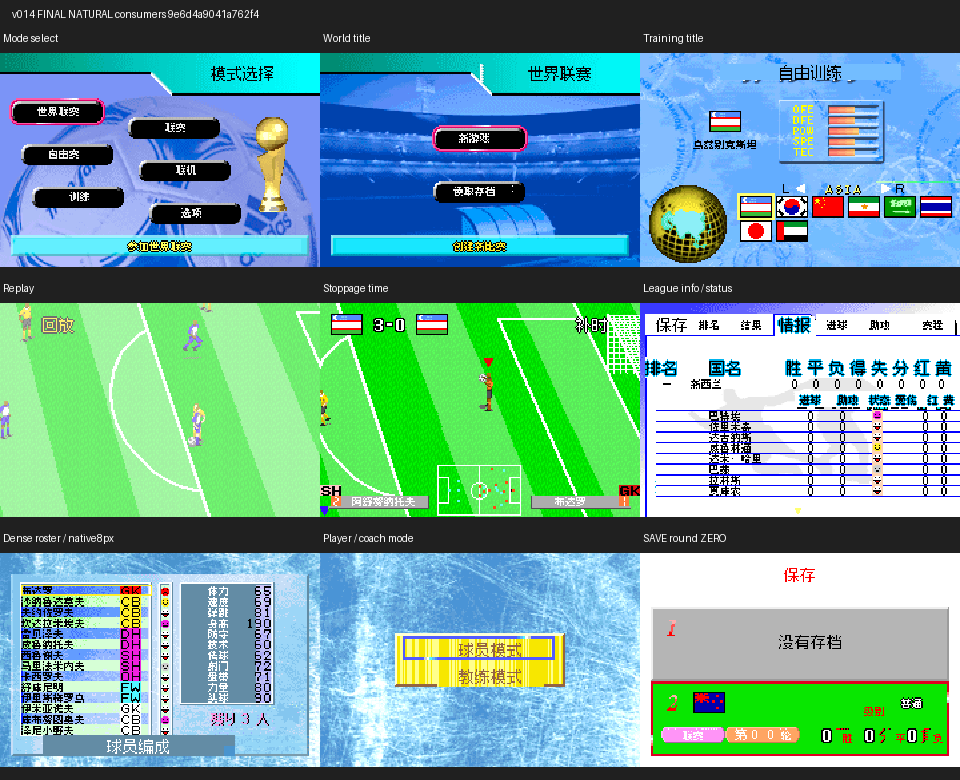
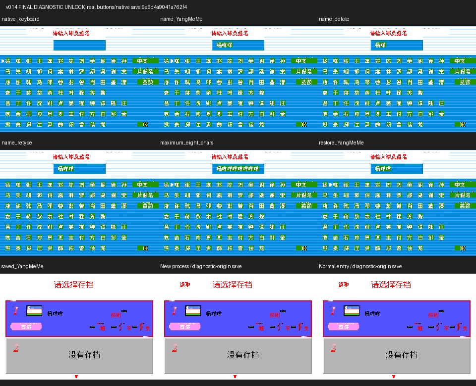

# 世界足球迈向胜利之路

原输入：World Advance Soccer - Shouri e no Michi (Japan)

原输入完整SHA256：`36ad536b794755155b57cc4a451284a60fa8cb331723c34a6aa6bcaa30362834`。此处“原输入”保留改版、既有汉化或地区修订身份，不一律称干净零售ROM。

| 字号 | 当前版本 | 音频 | 输出完整SHA256 |
| --- | --- | --- | --- |
| native8-12 | v0.1.4限定修复测试版 | unchanged | `9e6d4a9041a762f49dd5d0dd4eda6aa9bb50855a4d0829588362c279fad21375` |

## 源码与补丁

- native8-12／v0.1.4限定修复测试版／unchanged：源码包（完整性未独立确认）：[下载](https://github.com/shiyi1133/youxi-hanhua-releases/releases/download/source-migration-20261022-02c/world-advance-soccer-current-source-55fe048af87c-public-r01.zip)（ZIP SHA256 `c8c5e10752caaf9f010929732d1be8a1a331c2ffbcf26bc1119d2f5753313374`）；补丁：[下载](https://github.com/shiyi1133/youxi-hanhua-releases/releases/download/patch-migration-20261022/world-advance-soccer-current-patches.zip)（ZIP SHA256 `d721445d8df960818a11e9de3999ffc230bb990269c3186a0cbb690374514616`）。
  该包已核对对应版本与字节安全；完整修改源码覆盖范围未独立确认。

补丁须直接应用于完整SHA一致的实际原输入；普通字、大字和音乐变体分别核对。公开源码归档不表示本轮重新构建或通过新的运行验收。原作、字体、已有翻译及工具依赖的权利与许可，依各包对应许可保留。

## 范围与验证边界

- native8-12／v0.1.4限定修复测试版：普通原生8px UI / 原生12px图像字；无独立大字版。
  既有反馈合并限定修复：12px基线、图块/标题/底纹、多个菜单和统计独立消费者、阵形列表/条件/保存；残留与深层范围未全验，既有反馈保持open。
  v0.1.4 合并限定修复测试版；整个 既有反馈 和玩家 22 张反馈图仍未全部解决，既有反馈 保持 open。
  普通原生 8px UI 与原生较大 12px 图像字，使用 Fusion Pixel；这是同一普通版本，无独立 10px 或大字 ROM。
  继承 v0.1.1 的 12px FONT_ASCENT 基线修复、v0.1.2 标题足球图案/底纹/国家名/联赛与统计标签、v0.1.3 暂停/回放/补时/子菜单等已记录修复；本次不把继承内容冒称全部新修。
  v0.1.4 新增阵形自定义/默认原生 y32 与背景恢复，赛前详细条件九行与选项，世界联赛独立三页标题/字段，独立保存短标题及槽位图像修正。
  提供方记录本目标 25 条回放：22 条自然路径、2 条诊断解锁、1 条自然载入入口读取诊断来源存档；维护仅核回执与原帧，未新运行游戏或源码。
  自然自由赛上下半场至真实 RESULT 与终场统计有对应帧；旧文件名 11_match_end/12_results 实为中场，不能作终场证据。
  联赛保存/新进程冷读只在开局第 0 节；世界联赛保存/重复保存/冷读只在开局分组，零场完成，不能称赛季进度保存验收；重复保存没有确认框，B 只是返回。
  诊断命名只注入解锁标志，之后原生按键输入杨咩咩、重复、删除重输、八字、保存/冷读；不能称自然解锁或已有球员再改名已通过。
  三张九宫格原字节保留，27 格均逐像素绑定至本目标回放原生 240×160 帧的最近邻展示。Natural 与 Consumers 都有自然来源；Diagnostic 全图明确诊断/诊断来源存档。重复画面可对应多个步骤，不能称 27 个不同场景。
  密集名单/键盘保持原生 8px，不能称所有字形完美可读；世界联赛深层独立统计/标签、其它通信错误/交换/实际联机、育成新标题自然解锁及部分英文装饰/缩写仍未全验。
  玩家原反馈 ROM 文件名/完整 SHA 未知；已有短入口可继续排查，不能统一写成等待玩家补材料。原日版黄白竖条和部分边缘裁切有原件对照，不一概称汉化故障。
  提供方更正：实际 RESULT 的舒库尼明、伊里斯梅罗乌、扎尼南已是中文姓名，v0.1.2 曾误判为残日文；其它得分者入口未穷尽。
  保存格式/原生数值与菜单事件未改是提供方静态声明；维护独立复核 v0.1.3→v0.1.4 原 8 MiB 区段变化 2073 字节，与声明一致，不据此证明全部程序语义。
  实机、成功联机、完整流程、进度赛季保存、旧版存档迁移和旧即时状态兼容均未通过本次验收；请保留个人旧档。
  提供方封存完整源码空目录重建回执不是本轮维护重建，也不是独立人员 QA；源码完整留本地、本批上传 Source 数量为 0。
  四个版本 ZIP 安全/CRC 与原输入独立 IPS 精确还原均通过。旧 v0.1.2 的 HASHES.json 自记录过时，其余成员实际匹配；旧版仅本地历史保留，不发旧版。

本次资料搬运未新增模拟器、实机或全通验收；未记录或未测试的范围不写成通过。问题单开放只表示尚未关闭，已关闭也不单独证明全部场景都修复。

[公开反馈及问题状态](feedback.md) · [报告BUG](https://github.com/shiyi1133/youxi-hanhua-releases/issues/new?template=bug_report.md)

## 对应版本截图

v0.1.4普通原生8/12px自然路径：标题、赛前条件、阵形、世界联赛与开局保存、真实终场结果/统计、开局联赛冷读；不是全流程验收

图像SHA256：`83de866f40d802707213ffce6633cb3df80b1671e8ef0793be5e57a361076568`；绑定ROM SHA256：`9e6d4a9041a762f49dd5d0dd4eda6aa9bb50855a4d0829588362c279fad21375`。

v0.1.4普通原生8/12px自然独立界面补充：模式、世界联赛/训练标题、回放/补时、联赛情报、密集名单和第0节保存

图像SHA256：`5050b8faf1e377d79ca3e5375f2def54e3df037119517df0023cefef9db7ee3c`；绑定ROM SHA256：`9e6d4a9041a762f49dd5d0dd4eda6aa9bb50855a4d0829588362c279fad21375`。

v0.1.4普通原生8/12px诊断解锁后命名/删除重输/八字/原生保存与冷读；末格正常入口读取的仍是诊断来源存档，非自然解锁

图像SHA256：`c81849320bed8570ec8ade2121ece939bfe84a6b8a6cde9e9c4b18084cd8310d`；绑定ROM SHA256：`9e6d4a9041a762f49dd5d0dd4eda6aa9bb50855a4d0829588362c279fad21375`。

