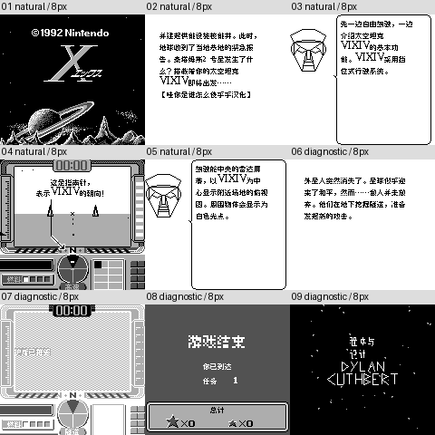

# X（日版） v0.1.0（限定测试版）

[源码与补丁Release](https://github.com/shiyi1133/youxi-hanhua-releases/releases/tag/x-gb-v0.1.0) · [公开反馈](feedback.md) · [报告BUG](https://github.com/shiyi1133/youxi-hanhua-releases/issues/new?template=bug_report.md)

原游戏／实际输入：X (Japan)

原输入完整SHA-256：`d6b1e41a17244770ba3675efc73ea19cc049cb413bf6c29125b6983c6f800f61`（262144字节）。

范围：X黑白GB精确日版输入的菜单、教程、任务及已识别图字；MBC2电池，不扩ROM。

## 8px v0.1.0

字号范围：普通8px；标题2倍图字和结尾3D线条不是独立大字版。无10px。

目标完整SHA-256：`774f22aca82de1024f42f5850136fe4a09e248ac9321b591659571943eef3970`（262144字节）。

补丁：`x-gb-v0.1.0-8px.bps`，SHA-256 `d6119d190166c84fa29a8e208baafc0088e092e991fba9da813c8880eba91732`。

[源码（完整性未独立确认）](https://github.com/shiyi1133/youxi-hanhua-releases/releases/download/x-gb-v0.1.0/x-gb-v0.1.0-source-public-r02.zip) · [补丁包](https://github.com/shiyi1133/youxi-hanhua-releases/releases/download/x-gb-v0.1.0/x-gb-v0.1.0-patch.zip)

X（日版） v0.1.0 8px限定测试版；普通8px；标题2倍图字和结尾3D线条不是独立大字版。无10px。 自然路径与诊断范围见测试说明，不代表全流程。

## 测试及限制

提供者自然路径：开机开场、教官及训练驾驶HUD；没有完成训练关或首关验收。

提供者诊断路径：任务2–10、死亡统计/重启和结尾名单来自场景诊断，不是自然通关。

保存边界：未验有效进度保存与冷读，MBC2有电池不等于已验证保存。

同一实现者自测，不是独立人员QA；维护未新增ROM运行或源码重建，未宣称实机或完整通关。

- 未验证：训练关自然过关
- 未验证：实际命名/密码/有效存档冷读
- 未验证：全十任务、最长变量、实机及全通
- 核对补丁还原、资产完整SHA和截图字节不等于全部游戏功能验收。

