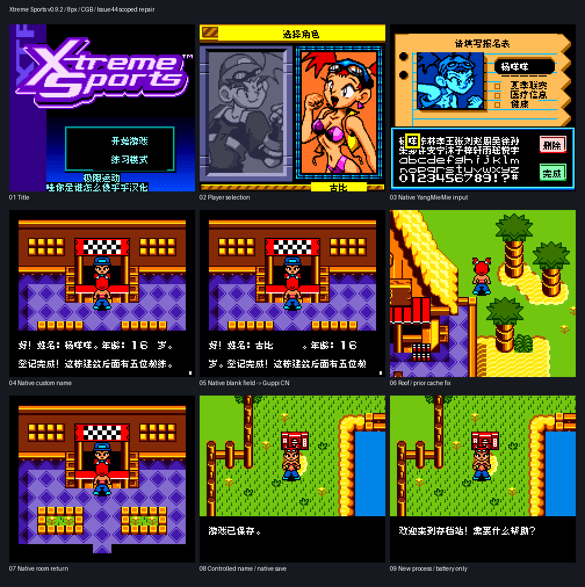

# 极限运动

原输入：Xtreme Sports

原输入完整SHA256：`c7cc3b37b21529a933c4e5c11582a5e111911130bfb9f1797f7cb32c983d69e8`。此处“原输入”保留改版、既有汉化或地区修订身份，不一律称干净零售ROM。

| 字号 | 当前版本 | 音频 | 输出完整SHA256 |
| --- | --- | --- | --- |
| 8px | v0.9.2 | unchanged | `e3e408080ff223ed17b88f84915e0a4a4e1e229f72978536f1123db63aab8cbe` |

## 源码与补丁

- 8px／v0.9.2／unchanged：完整修改源码：[下载](https://github.com/shiyi1133/youxi-hanhua-releases/releases/download/source-migration-20261022/xtreme-sports-current-source-d4cceb7ddfa0-public-r02.zip)（ZIP SHA256 `d5baf443f69183c32d3998640c661890583cd5094171c6f3edd1fe232727d7cb`）；补丁：[下载](https://github.com/shiyi1133/youxi-hanhua-releases/releases/download/patch-migration-20261022/xtreme-sports-current-patches.zip)（ZIP SHA256 `f3f0c7b8777eb0bd766d5e763b915bbbc4372c2cfef223169a283348ab3bbfef`）。

补丁须直接应用于完整SHA一致的实际原输入；普通字、大字和音乐变体分别核对。公开源码归档不表示本轮重新构建或通过新的运行验收。原作、字体、已有翻译及工具依赖的权利与许可，依各包对应许可保留。

## 范围与验证边界

- 8px／v0.9.2：原生8px普通版；完整10px未交付。

本次资料搬运未新增模拟器、实机或全通验收；未记录或未测试的范围不写成通过。问题单开放只表示尚未关闭，已关闭也不单独证明全部场景都修复。

[公开反馈及问题状态](feedback.md) · [报告BUG](https://github.com/shiyi1133/youxi-hanhua-releases/issues/new?template=bug_report.md)

## 对应版本截图

8px CGB当前实际ROM：自然取名/场景、受控姓名原生保存与新进程仅电池冷读

图像SHA256：`e3c05375e5e718317e5c7d1a537d74eb1e23f7b0f106c43228c3de8b76fee84b`；绑定ROM SHA256：`e3e408080ff223ed17b88f84915e0a4a4e1e229f72978536f1123db63aab8cbe`。

