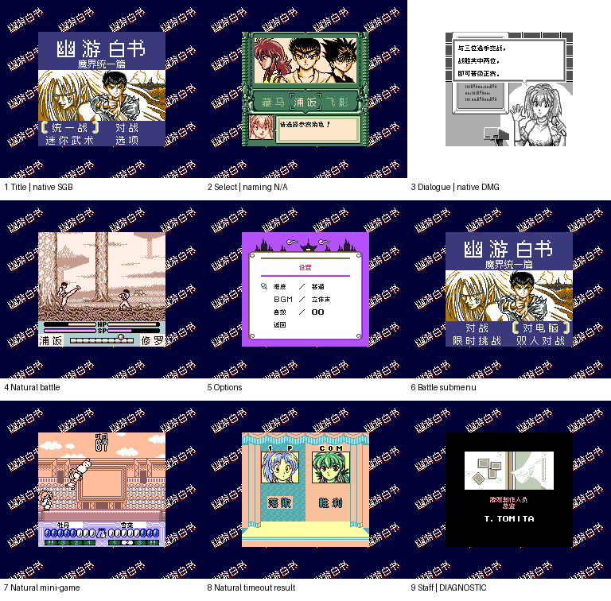

# 幽游白书4

原输入：Yuu Yuu 4 (Japan; requester archive and YUUYUU-4 cartridge header identity)

原输入完整SHA256：`9b5dbe11021ce2ff458c182ef0c9eb2baab093c58a7c0d703674cf64fe70db70`。此处“原输入”保留改版、既有汉化或地区修订身份，不一律称干净零售ROM。

| 字号 | 当前版本 | 音频 | 输出完整SHA256 |
| --- | --- | --- | --- |
| 8px | v0.1.0 | unchanged | `715fffa9289efed9a7ea54a6de89670ccd78009b7c462eac76e982dd991a97e9` |

## 源码与补丁

- 8px／v0.1.0／unchanged：源码包（完整性未独立确认）：[下载](https://github.com/shiyi1133/youxi-hanhua-releases/releases/download/source-migration-20261022-02c/yuu-yuu-hakusho-4-current-source-538c6a53d510-public-r01.zip)（ZIP SHA256 `2c1813471ea60d73ccbe9cc8b845d55cc3b5cb4abcd1d39845b1d6e4e15f0bc2`）；补丁：[下载](https://github.com/shiyi1133/youxi-hanhua-releases/releases/download/patch-migration-20261022/yuu-yuu-hakusho-4-current-patches.zip)（ZIP SHA256 `b5151cdcfc33bf234e11e944557bdf12d56c1516b52de8d6e8a4641dda5c9be2`）。
  该包已核对对应版本与字节安全；完整修改源码覆盖范围未独立确认。

补丁须直接应用于完整SHA一致的实际原输入；普通字、大字和音乐变体分别核对。公开源码归档不表示本轮重新构建或通过新的运行验收。原作、字体、已有翻译及工具依赖的权利与许可，依各包对应许可保留。

## 范围与验证边界

- 8px／v0.1.0：Fusion Pixel原生8×8普通对白；12px源字模只用于原尺寸静态图像，没有10px/12px运行时版本。
  原生8px对白、菜单与图像文字；指定自然启动、选角、对话、战斗、迷你模式样本，深层赛程和职员表诊断另列。
  仅普通8px，未交付真正10px。
  130指针入口中的119项已翻译；11调试/遗留入口保留原文，自然可达性未独立认证。
  自然启动/选角/对白/菜单/部分对战及迷你超时有provider目标SHA报告；深层赛程、部分结局和职员表含诊断入口。
  全人物招式、全难度/通关、所有结局自然触发、双机通信、原机/烧录卡与硬件帧率未验收。
  维护会话仅静态、补丁、PNG和独立重建核验，不冒称新模拟器运行或玩家QA。

本次资料搬运未新增模拟器、实机或全通验收；未记录或未测试的范围不写成通过。问题单开放只表示尚未关闭，已关闭也不单独证明全部场景都修复。

[公开反馈及问题状态](feedback.md) · [报告BUG](https://github.com/shiyi1133/youxi-hanhua-releases/issues/new?template=bug_report.md)

## 对应版本截图

幽游白书4 v0.1.0 普通8px限定测试版；8格provider自然输入（含原生SGB彩色与DMG黑白），第9格工作人员表为诊断入口

图像SHA256：`fcb7b1eb53b669a7303d3228156ff19f2daa118d365ac78a0abbc9e0cabda54e`；绑定ROM SHA256：`715fffa9289efed9a7ea54a6de89670ccd78009b7c462eac76e982dd991a97e9`。

