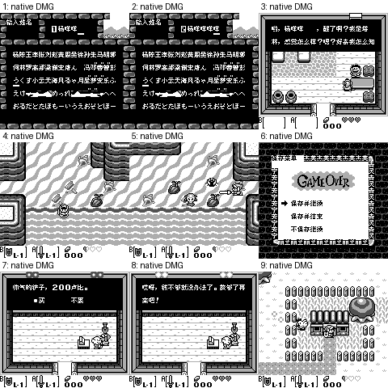

# 塞尔达传说 梦见岛 黑白GB版

原输入：Zelda no Densetsu - Yume o Miru Shima (Japan) (Rev 1)

原输入完整SHA256：`d37d36cc47e42a42146ef04bed47d2fe127f5f98daf9cb499dc1a0e676574e78`。此处“原输入”保留改版、既有汉化或地区修订身份，不一律称干净零售ROM。

| 字号 | 当前版本 | 音频 | 输出完整SHA256 |
| --- | --- | --- | --- |
| 8px | v0.1.0 | unchanged | `da51080f3300841d1f0c9ee0950b38b857df2ae543cf9bc771fca11de545b355` |

## 源码与补丁

- 8px／v0.1.0／unchanged：源码包（完整性未独立确认）：[下载](https://github.com/shiyi1133/youxi-hanhua-releases/releases/download/source-migration-20261022-02c/zelda-links-awakening-gb-current-source-f9b472c46962-public-r01.zip)（ZIP SHA256 `9439024a40dd9e79aa059e69e3aede8bf197d51b046dc32e48c7b600a6576d02`）；补丁：[下载](https://github.com/shiyi1133/youxi-hanhua-releases/releases/download/patch-migration-20261022/zelda-links-awakening-gb-current-patches.zip)（ZIP SHA256 `2024705176fce29c8a1b062a3b55550ee442ed896b6105d8d534de6eafcf8da5`）。
  该包已核对对应版本与字节安全；完整修改源码覆盖范围未独立确认。

补丁须直接应用于完整SHA一致的实际原输入；普通字、大字和音乐变体分别核对。公开源码归档不表示本轮重新构建或通过新的运行验收。原作、字体、已有翻译及工具依赖的权利与许可，依各包对应许可保留。

## 范围与验证边界

- 8px／v0.1.0：原生8px普通字；无大字版；非DX、无SGB彩色。。
  日本Rev1黑白GB非DX/非GBC/非SGB，普通8px；640指针槽/564独立文本、已识别菜单文字中文实现；16格行宽/32格分页/原五字姓名，有限32姓/32名字表及16原字符位置；原艺术标题和GAMEOVER美术保留，无10px。
  敌人击杀胜利
  商店实际付款成功与偷窃事件
  钓鱼/娃娃机
  全迷宫/全剧情/结局
  全部动态最长数值
  实机
  跨其他汉化存档兼容

本次资料搬运未新增模拟器、实机或全通验收；未记录或未测试的范围不写成通过。问题单开放只表示尚未关闭，已关闭也不单独证明全部场景都修复。

[公开反馈及问题状态](feedback.md) · [报告BUG](https://github.com/shiyi1133/youxi-hanhua-releases/issues/new?template=bug_report.md)

## 对应版本截图

塞尔达传说 梦见岛 黑白GB版 v0.1.0 8px；原生8px普通字；无大字版；非DX、无SGB彩色。；最终ROM真实九宫格（自然/诊断/续行边界按本说明）

图像SHA256：`d5297d373c88c233fa774a78ebeacaf3aa6ac1cc167632d2c5f17963963bd279`；绑定ROM SHA256：`da51080f3300841d1f0c9ee0950b38b857df2ae543cf9bc771fca11de545b355`。

