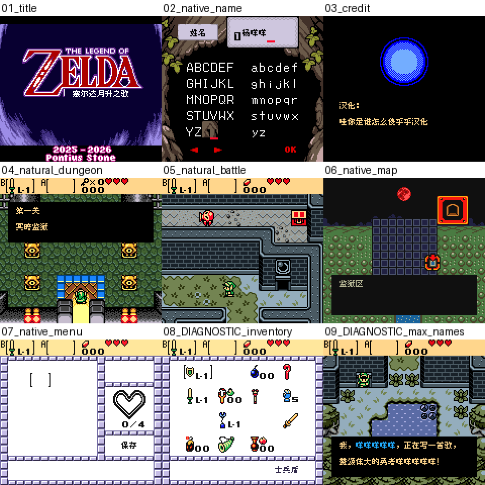

# 塞尔达月升之歌

原输入：Zelda - Moonrise Regalia (provider named v1.0.6; modified Oracle of Ages input); full gameplay/script language and hack version not independently certified

原输入完整SHA256：`5369091fd491cacad9be15d39860aaa04d741b3804d6b129c735dc32af03f35d`。此处“原输入”保留改版、既有汉化或地区修订身份，不一律称干净零售ROM。

| 字号 | 当前版本 | 音频 | 输出完整SHA256 |
| --- | --- | --- | --- |
| 8px | v0.1.0 | unchanged | `1348bf23240bfe6f242f8a7c700223bd540e779c62111b3dbd658df8d8e51265` |

## 源码与补丁

- 8px／v0.1.0／unchanged：源码包（完整性未独立确认）：[下载](https://github.com/shiyi1133/youxi-hanhua-releases/releases/download/source-migration-20261022-02c/zelda-moonrise-regalia-current-source-5f31b478228e-public-r01.zip)（ZIP SHA256 `e444d875de86dbc9c31f42983ec82ce39c4e238f2fe87581c6a1e6d731a65f4c`）；补丁：[下载](https://github.com/shiyi1133/youxi-hanhua-releases/releases/download/patch-migration-20261022/zelda-moonrise-regalia-current-patches.zip)（ZIP SHA256 `d709bd9c08d40df9255ba7c3df47716898e55d5ae4ff48edb29b1772da679e71`）。
  该包已核对对应版本与字节安全；完整修改源码覆盖范围未独立确认。

补丁须直接应用于完整SHA一致的实际原输入；普通字、大字和音乐变体分别核对。公开源码归档不表示本轮重新构建或通过新的运行验收。原作、字体、已有翻译及工具依赖的权利与许可，依各包对应许可保留。

## 范围与验证边界

- 8px／v0.1.0：普通8px字形置于原生8×16对话字格；本次无大字版本；原生CGB彩色。。
  2838索引中2832非占位条目已译，6个meep占位原文保留。基于请求者提供的AZ8E修改版原输入；v1.0.6为提供者标注，未独立认证。保留原ZELDA/Nintendo/Pomius Stone归属、口令字符及必要OK/BACK。早期自然取名、开场、取得剑、基本战斗、首迷宫入口、菜单及保存冷读有提供者实测；全文/变量/道具栏另有明确诊断。
  首关未通；自然商店购买扣款/物品入袋闭环、深层地图剧情/结局、全部小游戏、子女取名实际事件、完整复制删除、有效口令/联机及实机未测。九宫格第8库存/第9最长姓名是诊断；不代表自然获得道具。仅匹配给定修改输入，旧即时状态不可跨ROM，原生电池档应先备份，全部历史进度兼容未保证。

本次资料搬运未新增模拟器、实机或全通验收；未记录或未测试的范围不写成通过。问题单开放只表示尚未关闭，已关闭也不单独证明全部场景都修复。

[公开反馈及问题状态](feedback.md) · [报告BUG](https://github.com/shiyi1133/youxi-hanhua-releases/issues/new?template=bug_report.md)

## 对应版本截图

普通8px v0.1.0最终ROM原生CGB九宫格；第8库存和第9最长姓名为明确诊断，保留原标签，不作自然通关证明。

图像SHA256：`1f6426ecd6dd8fa5f8e7ef222d5a6f69a011615f25fed560608b9e47d9fc2454`；绑定ROM SHA256：`1348bf23240bfe6f242f8a7c700223bd540e779c62111b3dbd658df8d8e51265`。

