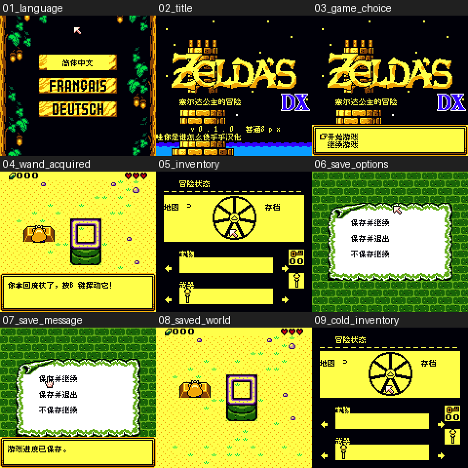

# 塞尔达公主的冒险DX v0.1.0（限定测试版）

[源码与补丁Release](https://github.com/shiyi1133/youxi-hanhua-releases/releases/tag/zeldas-adventure-dx-v0.1.0) · [公开反馈](feedback.md) · [报告BUG](https://github.com/shiyi1133/youxi-hanhua-releases/issues/new?template=bug_report.md)

原游戏／实际输入：塞尔达公主的冒险Zeldas.Adventure.DX.v2.2.0_20261021_112110.gbc

原输入完整SHA-256：`4eff20602acae5629814c93d9f8b363906654f94fefde2cfc50632f521335f23`（2097152字节）。

范围：精确DX v2.2.0改版基底的英语分支631原生文本槽（580普通/51带控制菜单路牌），15背景图像消费者。法德正文与专用菜单仍原文，共享图像中文不代表另两语言完成。汉化补丁工程不是原作者GB Studio编辑工程。

## 8px v0.1.0

字号范围：英语分支普通Fusion Pixel 8px；无10px，法德非完整汉化。

目标完整SHA-256：`88245557475deb183a2863599a692b288776e900e9640859d5d4e25db23684c0`（4194304字节）。

补丁：`zeldas-adventure-dx_v0.1.0_8px.bps`，SHA-256 `a79a2f99df5401b999343bf2e87ad7358851105f98840d915334e501628f8bc8`。

[源码（完整性未独立确认）](https://github.com/shiyi1133/youxi-hanhua-releases/releases/download/zeldas-adventure-dx-v0.1.0/zeldas-adventure-dx-v0.1.0-source-public-r02.zip) · [补丁包](https://github.com/shiyi1133/youxi-hanhua-releases/releases/download/zeldas-adventure-dx-v0.1.0/zeldas-adventure-dx-v0.1.0-patch.zip)

塞尔达公主的冒险DX v0.1.0 8px限定测试版；英语分支普通Fusion Pixel 8px；无10px，法德非完整汉化。 自然路径与诊断范围见测试说明，不代表全流程。

## 测试及限制

提供者自然路径：语言选择、标题、新游戏、换图、获得魔杖、状态图标、原生保存并继续完成确认事件；新OS进程仅电池Continue后魔杖图标仍在。

提供者诊断路径：原生VM文本路牌/长双行、场景入口制作角色说明/结尾；WRAM诊断不代表自然结局。游戏结束图像仅静态修改，诊断未稳定停留，不称通过。

保存边界：PROVIDER_SELFTEST_MEANINGFUL_NATIVE_SAVE_NEW_OS_COLD_READ

同一实现者自测，不是独立人员QA；维护未新增ROM运行或源码重建，未宣称实机或完整通关。

- 未验证：完整战斗胜利
- 未验证：自然商店买卖
- 未验证：所有物品法术与深层组合
- 未验证：全部路牌剧情
- 未验证：死亡全流程与自然结局
- 未验证：实机/全通
- 未验证：原版及其它版本旧档兼容
- 核对补丁还原、资产完整SHA和截图字节不等于全部游戏功能验收。

