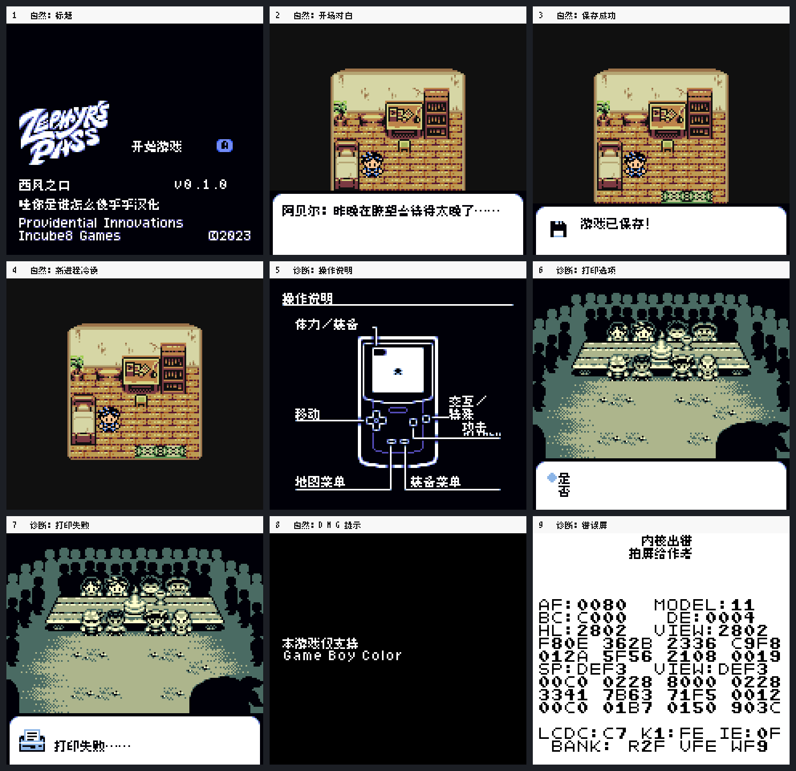

# 西风之口

原输入：Zephyr's Pass

原输入完整SHA256：`885f46e9a24b5ca822bb36cd5be7384e29fdc5a969391ff84ff00f4e46f8f8ad`。此处“原输入”保留改版、既有汉化或地区修订身份，不一律称干净零售ROM。

| 字号 | 当前版本 | 音频 | 输出完整SHA256 |
| --- | --- | --- | --- |
| 8px | v0.1.0 | unchanged | `a00d707ed5ad256575b2ce4ad00c809244ea15a09a21524ce13194da7186ca4f` |

## 源码与补丁

- 8px／v0.1.0／unchanged：源码包（完整性未独立确认）：[下载](https://github.com/shiyi1133/youxi-hanhua-releases/releases/download/source-migration-20261022-02c/zephyrs-pass-current-source-89beaf4ae91b-public-r01.zip)（ZIP SHA256 `84912e6b052ab3593d5ec100ae63ce5a779690a9806f25813bbeb13dc12cf4a7`）；补丁：[下载](https://github.com/shiyi1133/youxi-hanhua-releases/releases/download/patch-migration-20261022/zephyrs-pass-current-patches.zip)（ZIP SHA256 `86a0a0b578962417bf0c54722aada8a9670191c40f9319b12d3b9a18c519e2a4`）。
  该包已核对对应版本与字节安全；完整修改源码覆盖范围未独立确认。

补丁须直接应用于完整SHA一致的实际原输入；普通字、大字和音乐变体分别核对。公开源码归档不表示本轮重新构建或通过新的运行验收。原作、字体、已有翻译及工具依赖的权利与许可，依各包对应许可保留。

## 范围与验证边界

- 8px／v0.1.0：普通原生8px，CGB版；DMG仅不兼容提示。。
  普通原生8px，CGB版；DMG仅不兼容提示。
  未自然全通、未测实体GBC或打印机；打印及错误屏为明确诊断入口，不能当自然结局。

本次资料搬运未新增模拟器、实机或全通验收；未记录或未测试的范围不写成通过。问题单开放只表示尚未关闭，已关闭也不单独证明全部场景都修复。

[公开反馈及问题状态](feedback.md) · [报告BUG](https://github.com/shiyi1133/youxi-hanhua-releases/issues/new?template=bug_report.md)

## 对应版本截图

九宫格含自然标题/对白/保存/冷读及DMG提示，诊断操作说明/打印/错误屏另标。；对应 v0.1.0 8px 最终ROM。

图像SHA256：`631cc3f6e59353cdca9620495daeee43de497d0e31395b28d076eda58e17ebe3`；绑定ROM SHA256：`a00d707ed5ad256575b2ce4ad00c809244ea15a09a21524ce13194da7186ca4f`。

