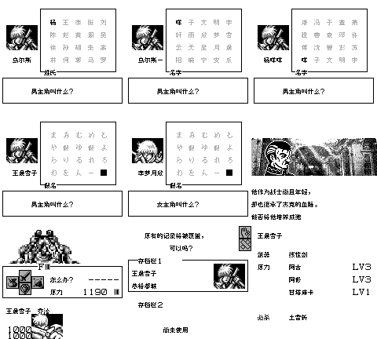

# 扎德传说2：伪神的领域

原输入：Zerd no Densetsu 2 - Xerd!! Gishin no Ryouiki

原输入完整SHA256：`c941a4f807bc02df3713c63034a250d9daf965e2a22e2fae9d461f0ebdaef858`。此处“原输入”保留改版、既有汉化或地区修订身份，不一律称干净零售ROM。

| 字号 | 当前版本 | 音频 | 输出完整SHA256 |
| --- | --- | --- | --- |
| 8px | v0.1.1 | unchanged | `58beec57ed1fe841d50061c87c9122f17bbec1d61363b750cdd395c23823f2ef` |

## 源码与补丁

- 8px／v0.1.1／unchanged：源码包（完整性未独立确认）：[下载](https://github.com/shiyi1133/youxi-hanhua-releases/releases/download/source-migration-20261022-04/zerd-no-densetsu-2-current-scope-source-public-r01.zip)（ZIP SHA256 `b15c30d03bb01a22859d9077761b984333c91c037d619e483c578cdcf42f7ad6`）；补丁：[下载](https://github.com/shiyi1133/youxi-hanhua-releases/releases/download/patch-migration-20261022/zerd-no-densetsu-2-current-patches.zip)（ZIP SHA256 `e4ecf01ac11f93527ff21c1b423a64207d19ffb60ee0fa035a5c65719bfb44f0`）。
  该包已核对对应版本与字节安全；完整修改源码覆盖范围未独立确认。

补丁须直接应用于完整SHA一致的实际原输入；普通字、大字和音乐变体分别核对。公开源码归档不表示本轮重新构建或通过新的运行验收。原作、字体、已有翻译及工具依赖的权利与许可，依各包对应许可保留。

## 范围与验证边界

- 8px／v0.1.1：原生普通8px。。
  命名键盘扩展为40姓+60名字，保留原假名/原生4字存储。
  提供者自身测试，不是维护方独立运行或独立人员QA；本轮未执行源码或ROM。
  v0.1.0覆盖只保留历史；不能将旧版自然/诊断场景自动当v0.1.1验收。
  提供者记录v0.1.0原生电池样本冷读；旧SAV字节未随包提供，本轮未载入复测，不外推所有旧档/模拟器兼容。
  新增汉字姓名不保证旧v0.1.0或未修改原版显示；不建议降级读取，跨版本即时状态不保证。
  未全流程、实机、全部深层事件/最长变量组合或自然死亡续关。
  两套姓名字段各40姓+60名字，每字段最多4字；100汉字×两字段200按键验收仅提供者报告。
  普通8px唯一版，无10px交付；九格无诊断入口标记，仍属提供者按键路线证据。
  覆盖保存取消/覆盖/新进程冷读与音效测试口令样本仅提供者报告；并非全部存档槽/所有取消组合通过。

本次资料搬运未新增模拟器、实机或全通验收；未记录或未测试的范围不写成通过。问题单开放只表示尚未关闭，已关闭也不单独证明全部场景都修复。

[公开反馈及问题状态](feedback.md) · [报告BUG](https://github.com/shiyi1133/youxi-hanhua-releases/issues/new?template=bug_report.md)

## 对应版本截图

扎德传说2：伪神的领域 v0.1.1 8px；原生普通8px。；最终ROM真实九宫格（自然/诊断/续行边界按本说明）

图像SHA256：`4e02ae156e27b4a99f44376a83f1727b0b9271f3e0be1b7ce8b1956af04de905`；绑定ROM SHA256：`58beec57ed1fe841d50061c87c9122f17bbec1d61363b750cdd395c23823f2ef`。

