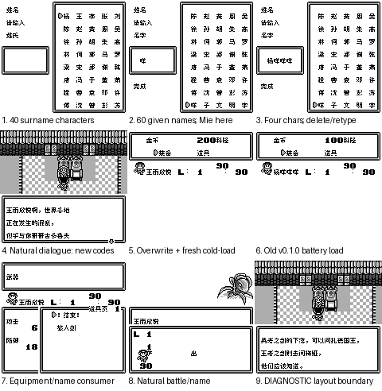

# 扎德传说

原输入：Zerd no Densetsu

原输入完整SHA256：`f987cd983a124651dd880dcb62a550555abac0f7f1312c311f9d91b7598ce2a3`。此处“原输入”保留改版、既有汉化或地区修订身份，不一律称干净零售ROM。

| 字号 | 当前版本 | 音频 | 输出完整SHA256 |
| --- | --- | --- | --- |
| 8px | v0.1.1 | unchanged | `1f1d91fb4830d9f325374d7ff1213e7431924c62c62e4776807fad464936b657` |
| 10px | v0.1.1 | unchanged | `57d7d4d5fa0812c5e8aa5596bd8f0d5a85fa967361b35ffd575d084493af7fbd` |

## 源码与补丁

- 8px／v0.1.1／unchanged：源码包（完整性未独立确认）：[下载](https://github.com/shiyi1133/youxi-hanhua-releases/releases/download/source-migration-20261022-04/zerd-no-densetsu-current-scope-source-public-r01.zip)（ZIP SHA256 `810c092dff58baf437ee32fc68eab6919c8ee428f448bd1a10b1e29260fc08bb`）；补丁：[下载](https://github.com/shiyi1133/youxi-hanhua-releases/releases/download/patch-migration-20261022/zerd-no-densetsu-current-patches.zip)（ZIP SHA256 `ce97dbe32f28364c8ed671237725a9b4f54f7701a0e23166e1b8b75b0e113717`）。
  该包已核对对应版本与字节安全；完整修改源码覆盖范围未独立确认。
- 10px／v0.1.1／unchanged：源码包（完整性未独立确认）：[下载](https://github.com/shiyi1133/youxi-hanhua-releases/releases/download/source-migration-20261022-04/zerd-no-densetsu-current-scope-source-public-r01.zip)（ZIP SHA256 `810c092dff58baf437ee32fc68eab6919c8ee428f448bd1a10b1e29260fc08bb`）；补丁：[下载](https://github.com/shiyi1133/youxi-hanhua-releases/releases/download/patch-migration-20261022/zerd-no-densetsu-current-patches.zip)（ZIP SHA256 `ce97dbe32f28364c8ed671237725a9b4f54f7701a0e23166e1b8b75b0e113717`）。
  该包已核对对应版本与字节安全；完整修改源码覆盖范围未独立确认。

补丁须直接应用于完整SHA一致的实际原输入；普通字、大字和音乐变体分别核对。公开源码归档不表示本轮重新构建或通过新的运行验收。原作、字体、已有翻译及工具依赖的权利与许可，依各包对应许可保留。

## 范围与验证边界

- 8px／v0.1.1：原生普通8px。。
  命名键盘扩展为40姓+60名字，保留原假名/原生4字存储。
  提供者自身测试，不是维护方独立运行或独立人员QA；本轮未执行源码或ROM。
  v0.1.0覆盖只保留历史；不能将旧版自然/诊断场景自动当v0.1.1验收。
  提供者记录v0.1.0原生电池样本冷读；旧SAV字节未随包提供，本轮未载入复测，不外推所有旧档/模拟器兼容。
  新增汉字姓名不保证旧v0.1.0或未修改原版显示；不建议降级读取，跨版本即时状态不保证。
  未全流程、实机、全部深层事件/最长变量组合或自然死亡续关。
  10px只对白，输入/菜单/战斗仍8px；模拟器1帧按键接受延迟不代表实机帧率或无拖慢。
  两个九格第9格明确为同最终ROM状态恢复后的layout/2诊断入口，不是自然到达；其余保存冷读格各有电池来源。
  本版姓名40姓+60名字及原170假名，共270位置；自然新名/商店/装备/战斗/保存样本为提供者自测，未独立重跑。
- 10px／v0.1.1：真10px仅对白；密集菜单/战斗/取名等仍8px，独立排版；更易拖慢/刷新残留，请反馈。。
  命名键盘扩展为40姓+60名字，保留原假名/原生4字存储。
  提供者自身测试，不是维护方独立运行或独立人员QA；本轮未执行源码或ROM。
  v0.1.0覆盖只保留历史；不能将旧版自然/诊断场景自动当v0.1.1验收。
  提供者记录v0.1.0原生电池样本冷读；旧SAV字节未随包提供，本轮未载入复测，不外推所有旧档/模拟器兼容。
  新增汉字姓名不保证旧v0.1.0或未修改原版显示；不建议降级读取，跨版本即时状态不保证。
  未全流程、实机、全部深层事件/最长变量组合或自然死亡续关。
  10px只对白，输入/菜单/战斗仍8px；模拟器1帧按键接受延迟不代表实机帧率或无拖慢。
  两个九格第9格明确为同最终ROM状态恢复后的layout/2诊断入口，不是自然到达；其余保存冷读格各有电池来源。
  本版姓名40姓+60名字及原170假名，共270位置；自然新名/商店/装备/战斗/保存样本为提供者自测，未独立重跑。

本次资料搬运未新增模拟器、实机或全通验收；未记录或未测试的范围不写成通过。问题单开放只表示尚未关闭，已关闭也不单独证明全部场景都修复。

[公开反馈及问题状态](feedback.md) · [报告BUG](https://github.com/shiyi1133/youxi-hanhua-releases/issues/new?template=bug_report.md)

## 对应版本截图

扎德传说 v0.1.1 8px；原生普通8px。；最终ROM真实九宫格（自然/诊断/续行边界按本说明）

图像SHA256：`f7b6218788074947604a72a0ef6f4104a98688e97942902c1c9440ea68ddc402`；绑定ROM SHA256：`1f1d91fb4830d9f325374d7ff1213e7431924c62c62e4776807fad464936b657`。

扎德传说 v0.1.1 10px；真10px仅对白；密集菜单/战斗/取名等仍8px，独立排版；更易拖慢/刷新残留，请反馈。；最终ROM真实九宫格（自然/诊断/续行边界按本说明）

图像SHA256：`5b5b4dd3fb50e600b7d571d0e0a658d5be331c3ef53784cfaa82c68eda4ba3be`；绑定ROM SHA256：`57d7d4d5fa0812c5e8aa5596bd8f0d5a85fa967361b35ffd575d084493af7fbd`。

