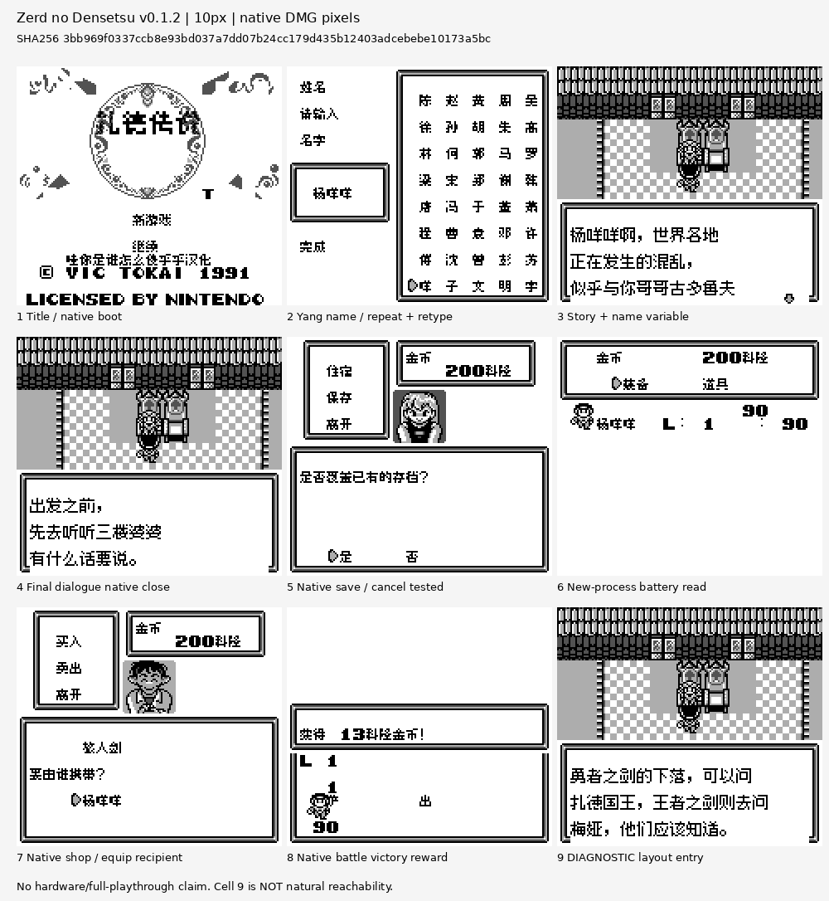
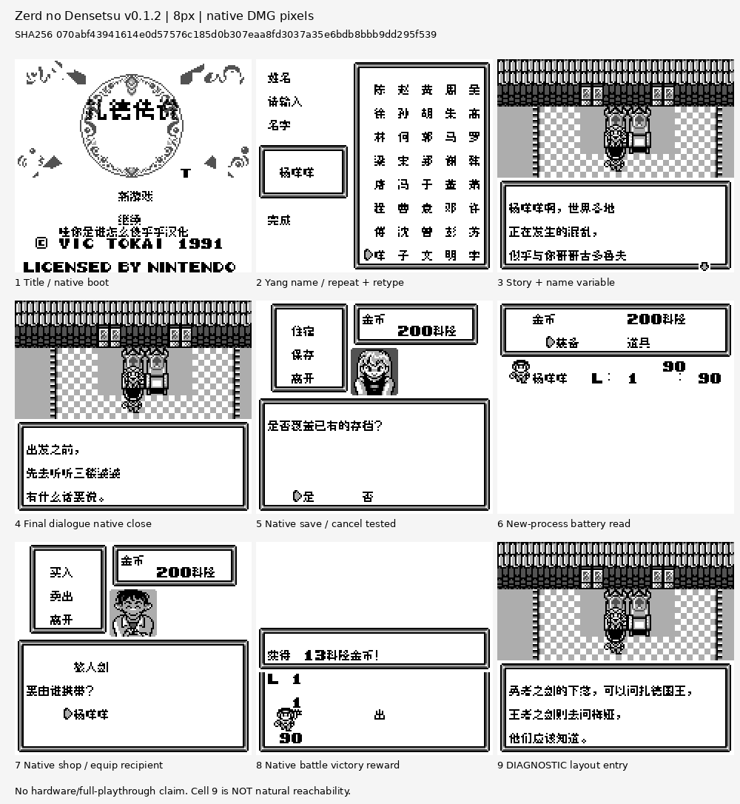

# 扎德传说 v0.1.2（限定测试版）

[源码与补丁Release](https://github.com/shiyi1133/youxi-hanhua-releases/releases/tag/zerd-no-densetsu-v0.1.2) · [公开反馈](feedback.md) · [报告BUG](https://github.com/shiyi1133/youxi-hanhua-releases/issues/new?template=bug_report.md)

原游戏／实际输入：Zerd no Densetsu

原输入完整 SHA-256：`f987cd983a124651dd880dcb62a550555abac0f7f1312c311f9d91b7598ce2a3`（131072字节）。

范围：普通8px与既有10px对白分别修收窗后才恢复原假名字库，保留原生等待/收窗/翻页。

## 10px v0.1.2 / unchanged

字号范围：普通8px与既有10px对白分别修收窗后才恢复原假名字库，保留原生等待/收窗/翻页。

目标完整 SHA-256：`3bb969f0337ccb8e93bd037a7dd07b24cc179d435b12403adcebebe10173a5bc`（524288字节）。

补丁：`zerd-no-densetsu-v0.1.2-10px.bps`，SHA-256 `5496d79c619ad3fee3325935a46f059b12997eb73af063e3747ecb33f0eb1390`。

[源码（完整性未独立确认）](https://github.com/shiyi1133/youxi-hanhua-releases/releases/download/zerd-no-densetsu-v0.1.2/zerd-no-densetsu-v0.1.2-complete-source.zip) · [补丁包](https://github.com/shiyi1133/youxi-hanhua-releases/releases/download/zerd-no-densetsu-v0.1.2/zerd-no-densetsu-v0.1.2-patches.zip)

普通8px与既有10px对白分别修收窗后才恢复原假名字库，保留原生等待/收窗/翻页。；提供方对应最终ROM图证，具体自然/诊断类别见原图标签及材料；非维护运行、全通或实机验收。

## 8px v0.1.2 / unchanged

字号范围：普通8px与既有10px对白分别修收窗后才恢复原假名字库，保留原生等待/收窗/翻页。

目标完整 SHA-256：`070abf43941614e0d57576c185d0b307eaa8fd3037a35e6bdb8bbb9dd295f539`（524288字节）。

补丁：`zerd-no-densetsu-v0.1.2-8px.bps`，SHA-256 `c57c6f79617b70e7a36af856557946f859ef0d64aff1ba3ab6b61e6c32a57b25`。

[源码（完整性未独立确认）](https://github.com/shiyi1133/youxi-hanhua-releases/releases/download/zerd-no-densetsu-v0.1.2/zerd-no-densetsu-v0.1.2-complete-source.zip) · [补丁包](https://github.com/shiyi1133/youxi-hanhua-releases/releases/download/zerd-no-densetsu-v0.1.2/zerd-no-densetsu-v0.1.2-patches.zip)

普通8px与既有10px对白分别修收窗后才恢复原假名字库，保留原生等待/收窗/翻页。；提供方对应最终ROM图证，具体自然/诊断类别见原图标签及材料；非维护运行、全通或实机验收。

## 测试及限制

提供方自然范围：提供方报告的自然/正常按键流程，维护未重跑。

提供方诊断范围：提供方明确标注的受控消费者、解锁或边界测试，不能冒充自然到达。

保存边界：仅按具体版本材料，不推定所有旧存档兼容。

维护本轮独立核原输入、补丁逐字节还原、ZIP/CRC、Source安全与原图字节；未执行提供方源码、未重建或运行ROM，未宣称独立人员QA、实机或全流程验收。

- 未验证：维护仅独立核用户输入ZIP/ROM完整SHA、补丁逐字节还原、ZIP成员/CRC与源包静态材料；未执行提供者源码、重建工程或运行ROM。
- 未验证：运行、自然按键、受控诊断、保存/新进程冷读等范围以所附提供方报告分别为据，不冒充维护重跑、独立人员QA、玩家验收、实机或全流程通关。
- 未验证：使用前备份普通存档；不跨ROM版本/字号套用即时状态，旧电池兼容仅按提供方实际样本说明。

大字版更容易出现拖慢、刷新残留等问题，遇到请及时在原楼反馈。
