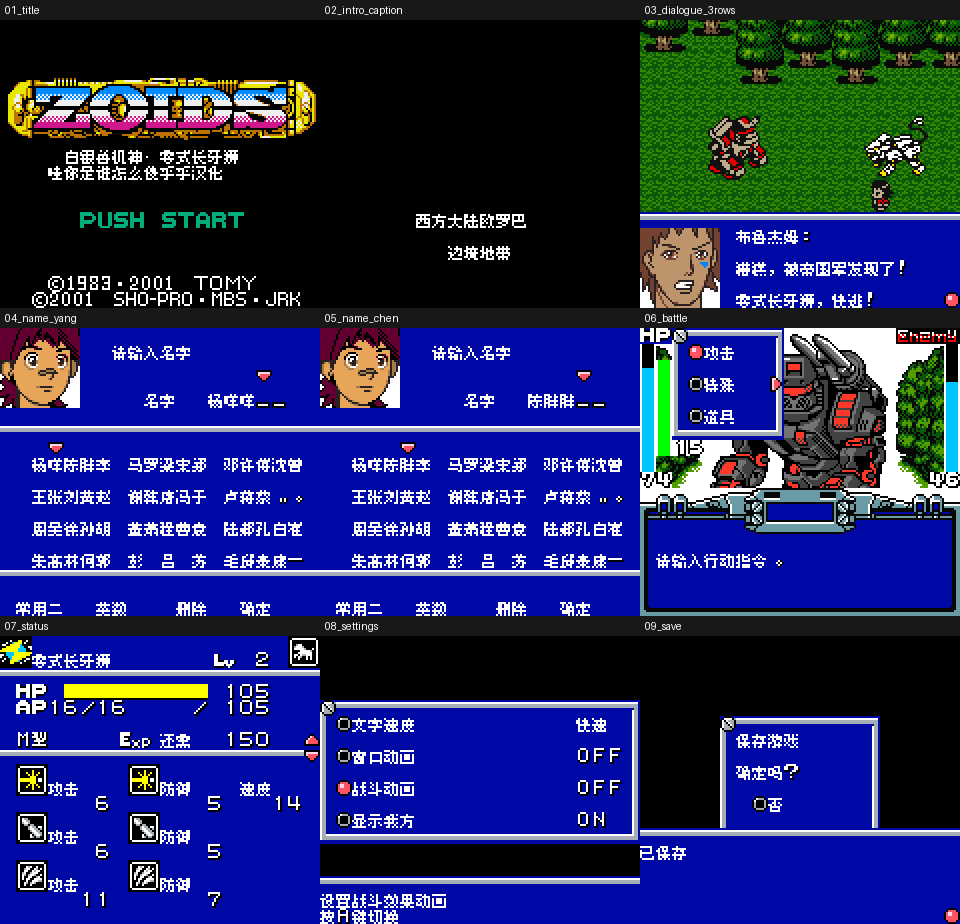

# Zoids：白银零式

原输入：Zoids Hakugin no Raiger Zero (Japan; requester filename/ZOIDSGBCJUN BZ2J cartridge header identity)

原输入完整SHA256：`01e1f16087e1ee3efeff19e4c8890d7aaa76016961d07b00b5f31f6b26035022`。此处“原输入”保留改版、既有汉化或地区修订身份，不一律称干净零售ROM。

| 字号 | 当前版本 | 音频 | 输出完整SHA256 |
| --- | --- | --- | --- |
| 8px | v0.1.0限定测试版 | unchanged | `9b39a2bf98ce61e4e46e8462dca8239469b25ce7dfc3e5373b9feb57b9e6f8d8` |

## 源码与补丁

- 8px／v0.1.0限定测试版／unchanged：完整修改源码：[下载](https://github.com/shiyi1133/youxi-hanhua-releases/releases/download/source-migration-20261022/zoids-hakugin-no-raiger-zero-current-source-3e1e21fc2e6f-public-r02.zip)（ZIP SHA256 `7e8802f8924410ab0fbab56e62a1ae93bf080038fa7e04f72be4c5fa866c8b25`）；补丁：[下载](https://github.com/shiyi1133/youxi-hanhua-releases/releases/download/patch-migration-20261022/zoids-hakugin-no-raiger-zero-current-patches.zip)（ZIP SHA256 `cbbc6a155edffe7154c076e921eea739646a2228eb1a49a5d82f171763170c8c`）。

补丁须直接应用于完整SHA一致的实际原输入；普通字、大字和音乐变体分别核对。公开源码归档不表示本轮重新构建或通过新的运行验收。原作、字体、已有翻译及工具依赖的权利与许可，依各包对应许可保留。

## 范围与验证边界

- 8px／v0.1.0限定测试版：原生Fusion Pixel 8px；无额外大字版。
  1847条非调试剧情、70机体、254装备名/253描述、70技能/70图鉴说明、390菜单及已定位标题字幕；静态条数不等于全流程覆盖
  保留3条未证实可达调试文字、原版权/ASCII口令等。
  九宫格前2格冷启动，后7格含同一最终ROM状态续测；额外自然命名/保存/电池冷读为提供方证据，非维护侧新增实玩。
  全部深层地图图像、商店完整买卖、最长变量、通关、全图鉴、实体硬件与多人未验证。
  原版可能把本版中文名显示为假名；备份旧档，不保证其它汉化或状态兼容。

本次资料搬运未新增模拟器、实机或全通验收；未记录或未测试的范围不写成通过。问题单开放只表示尚未关闭，已关闭也不单独证明全部场景都修复。

[公开反馈及问题状态](feedback.md) · [报告BUG](https://github.com/shiyi1133/youxi-hanhua-releases/issues/new?template=bug_report.md)

## 对应版本截图

v0.1.0限定测试版 普通8px；提供方最终ROM真实CGB九宫格：前2格冷启动，后7格包含同一最终ROM状态续测，非新增维护者实玩。 原生Fusion Pixel 8px；无额外大字版

图像SHA256：`64e4c432296ffc074030fc33e03775e87e7795a493686f72dd25af81a2e5990b`；绑定ROM SHA256：`9b39a2bf98ce61e4e46e8462dca8239469b25ce7dfc3e5373b9feb57b9e6f8d8`。

